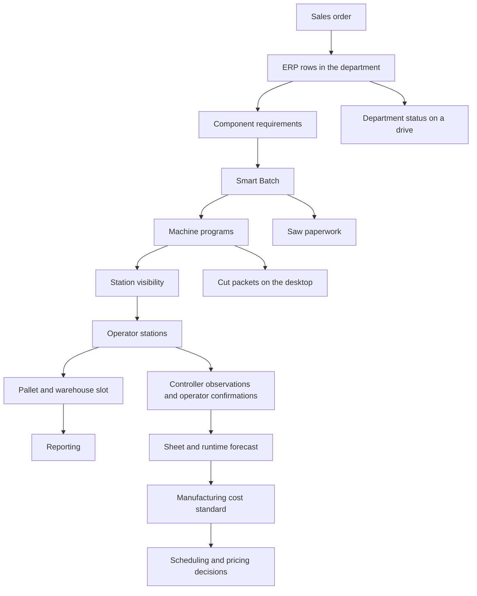

# Rejected site pass

Dustin reviewed this for 8 hours 50 minutes and still said no.

Do not treat this branch as a site to polish. He called the result dog shit, twice. After one pass he called it twenty minutes of reading. After the reading was cut, he looked again in Chrome and still said no. The live site at https://acor.dev/ was not updated. `main` was not moved.

This branch is the rejected work, so another agent can see it, laugh, and replace it. Start from the build plan below, not from these pages.

## What he was shown

A static portfolio for manufacturing systems. One invented day, July 14. No employer names, prices, or paths. The private suite was not modified and was not published.

The last homepage is a title, one sentence, a click-through of that day, nine app names, and a closing paragraph. The day step for the batch draws two invented sheets: grooved blocks for machined parts, plain strips in the gaps, and a saw list of 5. Next walks department rows, TAP and XPR/NC names, assign, mark one sheet ran, place a pallet, sheet and hour figures, then two outage panels.

Behind that are generic light-on-dark tables named Cut Department, Python Cut Station, Pallet Locator, Day Brief, Wood Usage, Cut Pricing, Machine log, and Department status. Warehouse Floor is a reserved empty page. `demos/build-order/` is a separate cabinet-quantity page with a production-nester export, wood texture, and groove marks. He rejected that drawing and said another agent would come back to it. It is still in this branch. `demos/smart-batch/` now only redirects home. The old pipeline, request, and station demos redirect.

## What was wrong

The November 7 build plan is the authority. This pass left it.

The plan's homepage is short, then deeper only by continuing. The order is: what the system is, an interactive pass from the sales order through Smart Batch to the pallet, the apps for that day, what that activity says about sheets and time, two separate outage tools, and who still decides.

The first build replaced that with essays. Eight numbered paragraphs, then a paragraph under every app, then the same points again. That is the twenty minutes of reading. Cutting the essays did not restore the plan. It left a menu. Story A, Story B, the outage pair, and who decides were no longer on the page as the plan ordered them. A later stream put a thin version of the day back on the homepage. He still said no.

Smart Batch was supposed to be the center, with cabinet choice already done: machined parts lock, 3 hand cuts use only open space, 5 stay on the saw, and Cut, the station, and the paperwork all show 2 sheets, 3 absorbed, 5 remaining. Those counts are in `demos/shared/shop-day.json`, and Cut repeats them. Nothing on the site is the real Cut Department screen, the real station, or the real pallet map. The pages are one shared table frame. Walk-up is a button that appends a line. Standard Library is a sentence. Push and Pull are buttons that change a note. The batch picture is invented rectangles, which the plan allowed, but it is not a screen a person would mistake for the product.

`shop-day.json` was added beside `manufacturing-day.json`. The plan said the shop day replaces that file. Job state is a status string plus a couple of flags, not the separate states the plan lists. The validator checks the 2 / 3 / 5 counts. It does not check that every page quoting the day still matches.

## Do not repeat

- Do not publish this branch to `main`.
- Do not keep writing explanations of the apps on the homepage.
- Do not draw another nest and call it finished. The cabinet-quantity page was rejected. Sides are not turned on their side. A tall side may be turned 180 degrees so the toe kick is at the near end. Bottoms stay on the router. Hand cuts do not add a sheet and do not move a locked part.
- Do not show a dollar amount, an employer name, or a UNC path.
- Do not describe department status and Cut's desktop packets as one outage tool.
- Omni output is TAP. The Python post is XPR/NC. Do not rename either one to match a slide.

## Most recent build plan

Copied here on 2026-11-08 from `acor.dev_app_overhaul_86a01d1b.plan.md` (written 2026-11-07 10:20 PM). This is the plan the rejected pass was supposed to follow.

---

# Acor.dev app overhaul

The public site is [DustinBobbitt/Acor.dev](https://github.com/DustinBobbitt/Acor.dev). It is not in this workspace. Clone it and edit only that repo. The private suite is not published.

This site is for showing the systems to someone: a coworker, a person met while networking, or a prospective employer, inside or outside an interview. The visitor should be able to watch a job move through the products and then open those products. It is a showcase of what was built, not a story about how it was built, and not a copy of an internal presentation.

The deck at `\\rog\CNC\Timberland Suite - Manufacturing Software and Systems (2).pptx` was read for that tour: which products exist, and how a job passes through them. The copy under `outputs/deck_2026-11-04/` is the same file. The deck's numbers are not site content. Material prices, the department rate, and job dollar totals from that employer never appear, including as lookalike fictional prices.

Behavior of each screen still comes from the suite, so a demo does not invent a product. `Timberland_Suite/kernel/registry.py` and the system overviews say what each app is. They are not a second homepage.

Smart Batch stays the centerpiece. `demos/shared/shop-day.json` stays the only fictional day. The apps stay sanitized copies of the real screens. Warehouse Floor still lands at `https://acor.dev/demos/warehouse-floor/` from `C:\Users\ksima\Mapping tool`, and that work does not block the rest.

The line under the tour: these systems sit beside an existing ERP and existing controllers, and the people who run the floor keep the decisions. It is not an autonomous factory.

## Homepage

Short, then deeper on demand. Order:

1. What this is: a connected system beside an existing ERP and existing controllers.
2. Story A, the interactive stream: sales order, ERP rows, component requirements, Smart Batch, machine programs and saw paperwork, release, stations, pallet, reporting.
3. The apps that carry that day.
4. Story B, which starts from the same activity: what the job needs, the sheets and time that implies, the machine log beside the operator's confirmations, and that a cost standard exists for leadership without any prices on screen. Capacity stays a direction, not a scheduler.
5. When the network is down: two separate tools, not one. Department status keeps moving from a saved workbook. Cut still produces machine packets onto the local day folder.
6. Who decides: operators and controllers run the machine, supervisors release and hold, executives set selling prices.
7. A short About, then Evidence and Experiments for anyone who asks what was in daily use. Those pages are not the tour.

Machine-file names follow the suite. Omni output is TAP. The Python post is the XPR/NC post already named that way in the architecture docs. The deck's shorter label, "NC," does not rename it, and the site does not ban the suite's word XPR.

## Smart Batch

Unchanged in structure. `demos/smart-batch/` is SVG and CSS, replayable, and `prefers-reduced-motion` shows the finished frame. Shapes are invented rectangles.

The rule, from `Timberland_Suite/docs/smart_batch_post_safety_algorithm_spec.md` and the latest direction:

- Cabinet selection is already done.
- Parts that must be machined nest first and lock.
- Eligible hand-cut parts may use only the gaps on those sheets.
- They do not move a locked part and they do not add a sheet.
- What does not fit, including shelves, goes to the saw.
- Paperwork lists the remainder: item, part, quantity.
- The nested sheets move into the station flow while that paperwork stays with the saw work.

Counts come from `shop-day.json`. The public example stays small: 2 sheets, 3 hand-cut parts absorbed, 5 remaining. Cut, the station queue, and the paperwork show those same numbers. The deck's 12 October run (15 cabinets, 4 jobs, 15 sheet programs) shows that a real batch of that size was generated. It is not the public scenario, and the site makes no material-savings claim.

Bottoms stay router-required, as the algorithm spec says. Slide 4's line that bottoms and strips fill leftover space is the compressed telling. It does not move bottoms into the optional fill.

## One shop day

`shop-day.json` replaces `demos/shared/manufacturing-day.json`. Jobs stay `DEMO-1042` (the animated batch), `DEMO-1047` (held, missing mapping), `DEMO-1054` (on a station), `DEMO-1058` (cut, waiting for a pallet).

Each job carries one cabinet count and separate states: generated, released, station-visible, loaded, machine-observed, operator-confirmed, and ready for a pallet. Marking one sheet ran does not complete the job. Outstanding sheets and the hand-cut remainder stay open. A controller-observed cycle and an operator confirmation are stored as different facts and may disagree.

One `localStorage` key, seeded from the file. Reset on any page restores the morning everywhere.

The shop day carries sheets, hours, and job status. It carries no material price, no department rate, and no dollar total.

## Apps

Static pages under `demos/`. Real layout and labels. No Advance / Run-to-outcome frame.

- **Cut Department** — `Timberland_Suite/cut_department/desktop.py`. Smart Batch, jobs by date, live batches, walk-up. Assigning a batch is what makes a station able to see it.
- **Python Cut Station** — `Timberland_Suite/tools/python_cut_station/app.py`. Sheet list, Standard Library, Move, Mark Ran. The registry lists it ready and published, so the page says that. Slide 6's "tested, not yet in production" is the presentation's caution. It does not downgrade the registry.
- **Hand-cut paperwork** — the remainder list inside Cut.
- **Cut Pallet Locator** — `Timberland_Suite/cut_palette_locator/frontend/index.html`, company logo and live endpoints removed.
- **Cut Day Brief** — the morning page for this day.
- **Wood Usage** — the product, on this shop day: upcoming work, sheet count, and estimated machine time. Time is labeled as a forecast from a fictional recent pace, or the stopwatch fallback when that pace is absent. No sheet price and no dollar total. In the suite, recent machine pace informs capacity hours and does not rewrite the cost standard (`Timberland_Suite/wood_usage/services/forecast_plan.py`). The page can say that in one sentence.
- **Cut Pricing** — the same four jobs, opened from the tour rather than as a new simulator. Each job shows cabinets, sheets, estimated hours, and status. The page says a manufacturing standard is built from sheet use and machine time, that a tighter nest does not by itself change that standard, and that the number is not a selling price. It does not show a material price, a department rate, or a dollar amount. Program-timed hours, where the suite has them, stay described as a model.
- **Machine log** — one page with two tracks for the same sheets: controller-observed cycles, and operator-confirmed progress. They are allowed to differ. FOCAS is the Omni observation only. The probe reads cycle, program, and alarms and sends no command. Python and the saw are not given the same coverage. No performance statistic is presented as a measured achievement.

EnRoute, ICN Reconcile, the program translator, the DXF generator, and Profile Manager stay mentions on the evidence page. Their labels come from the registry: published, development, or legacy. The deck helped see which of those belong in the story and which stay off the homepage. They do not become demos in this pass.

## When the network is down

These are products on the tour, the same shop day, two screens. They are not folded into Smart Batch and they are not described as one outage system.

- **Department status** — `demos/shop-floor/`. Sanitized Shop Floor Assistant and Shop Floor Orchestrator, from `Timberland_Suite/shop_floor_assistant/app.py` and `Timberland_Suite/shop_floor_assistant/orchestrator.py`. The department screen shows the invented jobs. Advancing one item changes only the local log. PUSH and PULL stay in the browser. The orchestrator screen is the real layout: the summary line and the department list, Progress as Received, Missing, or STALE, Delivery separate from Progress. A conflict stops the next round. A missing department stays on that list and does not stop the round, and the page does not add a confirmation the real app does not have. The recovery view is a list a person would use to update the ERP. The demo does not write an ERP. Coming back is that list, not an automatic post.
- **Cut on the desktop** — a mode on `demos/cut/`, not a second product name. Turning the share off, the way Cut's offline contingency does, makes Produce land in a local day folder the visitor can see. The same batch can then be opened on the station demo. This path produces machine files. It does not collect department status.

The copy does not say a timer inside those two apps captures the workbook, that the viewer opens the full recovery file by itself, that every department must report before the next round, or that offline work writes itself back. A saved workbook is what the department opens. The hourly recovery capture is a separate fact, told in one sentence if it is told at all: a full snapshot is kept on the machine for when the network is down, and someone opens it.

## Story B, without a scheduler

After the apps, a short section ties the same jobs to capacity:

known job requirements, plus estimated time, plus observed pace, plus work already in the department, gives a supervisor a clearer picture of the load.

Wood Usage and Cut Pricing are the built parts of that picture. An automatic capacity scheduler is not. The section says so.

## Warehouse Floor

Unchanged. `demos/warehouse-floor/index.html` is the placeholder. `demos/warehouse-floor/README.md` is the drop contract: static files only, invented facility, replace this folder, leave `work/warehouse-floor.html` as the written case study. Homepage card already points at `https://acor.dev/demos/warehouse-floor/`.

## About, evidence, and the old demos

About is a short note that these are the systems, they run from their own screens, and an agent is not required for them to run. The page does not become a development diary.

`/evidence/` keeps one page. A capability is labeled from the suite: published and ready, in development, legacy, or a direction the code does not yet implement. A slide category such as "daily use" is not copied onto the page when the registry says something more specific. Nav stays Apps, Warehouse, Evidence, Experiments, About.

Retire `demos/pipeline-explorer/`, `demos/request-receipt/`, and `demos/station-handoff/`. Old URLs redirect into the stream or the matching app. The geometry, traceability, and station essays become short pages on the stream. The warehouse case study stays.

## Validation

`tools/validate_site.py` checks routes, `shop-day.json` against every page that quotes it, the warehouse folder and homepage link, and the absence of company names, UNC paths, live hosts, material prices, and dollar amounts. It also fails copy that calls the system an autonomous factory, a selling-price engine, a finished scheduler, or a single outage tool that both posts status back to the ERP and requires every department before the next round.

## Done when

- Story A plays through Smart Batch, and Cut, the station, and the saw paperwork show the same 2 sheets, 3 absorbed parts, and 5 remaining.
- Story B uses those jobs: sheets and time with the time source named, a cost page with no prices on it, and a machine log whose two tracks can disagree.
- One sheet marked ran leaves the rest of the job open.
- Reset restores the morning on every page.
- The department-status demo can advance one invented item, show a missing department without blocking, stop on a conflict, and end on a recovery list. Cut's desktop mode writes the same batch to a local day folder the station demo can open.
- The warehouse URL is the placeholder, with the drop README, and nothing in this pass waits on the home agent.
- The validator passes.

## How the deck is used

The deck is a tour of the products: Cut, Smart Batch, the stations, the morning papers, the pallet locator, Warehouse Floor, wood usage, pricing, and the machine log. The outage tools were not on those slides. They are on the site because the software has them, not because the deck listed them.

The deck is not a script. Its material price, its department rate, and its job-cost arithmetic do not get a public version with the numbers swapped. Slide labels that disagree with the suite, such as Python Cut Station "not yet in production" or bottoms filling leftover space, are not site copy. Bottoms stay router-required. Python Cut Station stays what the registry says it is.
